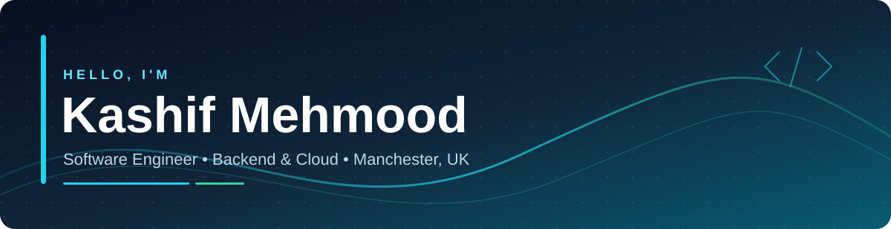

## 👋 About me

I'm a **software engineer based in Manchester, UK**, with **4+ years of professional experience** designing, building, and maintaining production web applications. My core focus is **Python, Django, PostgreSQL, REST APIs, AWS, Docker, and CI/CD**, alongside full-stack delivery with React, Vue, and TypeScript.

I enjoy taking ideas from requirements to architecture, deployment, and production support—especially systems involving **performance optimisation, operational workflows, cloud infrastructure, and AI-assisted automation**.

- 🚀 **Performance:** Reduced a critical API response time from **~3 seconds to ~0.03 seconds** through query optimisation, indexing, caching, and backend refactoring.
- ☁️ **Cloud efficiency:** Helped reduce AWS infrastructure spend from **over $12k/month** to a **forecast of ~$4.4k/month**.
- 🎓 **Education:** MSc Computer Science, **Distinction (90%)**, University of East London.
- 🤝 **Collaboration:** End-to-end delivery, code reviews, technical planning, mentoring, and working directly with international stakeholders.

## 🧰 Tech stack

**Backend & APIs**

     

**Frontend**

   

**Databases, cloud & DevOps**

       

## 💼 Selected professional work

> Much of my production engineering work is for clients or employers and is not publicly available on GitHub. The descriptions below are based on my professional experience, not claims of open-source ownership.

| Project | What I worked on | Technologies |
|---|---|---|
| **MEG CRM** | Energy-grants CRM and mobile-enabled workflows for eligibility, assessments, geotagged uploads, reporting, validations, and automated lead creation. | Laravel, Vue.js, Django, Python, PostgreSQL, AWS S3 |
| **Northwest Logistics Platform** | Loads, fleet and driver tracking, mileage, completed jobs, mapping, and operational revenue/performance dashboards. | Django, FastAPI, React, Vue.js, AWS RDS, GCP |
| **Car Guard** | Multi-tenant claims management with branded portals, configurable claim forms, and an administrative dashboard. | Django, Python, TypeScript, AWS ECS, CodeDeploy |
| **Veterinary healthcare platform** | AI-assisted OCR extraction and storage of historical patient records, plus production application work. | Django, React, TypeScript, GraphQL, AI/OCR |
| **Other client platforms** | Contributions across expert marketplaces, wellbeing, music streaming, and convention management software. | Ruby on Rails, Vue.js, React |

## 📈 GitHub activity

*GitHub widgets reflect visible repository activity, not the full scope of my client work.*

## 🏆 Recognition & education

- 🎓 **MSc Computer Science — Distinction (90%)**, University of East London (2025–2026)
- 🎓 **BS Computer Science**, Bahria University, Islamabad (2018–2022)
- 🌟 **Rising Star recognition**, Devsinc

---

### Let's build something useful.

**Scalable backends · Reliable integrations · Better developer workflows · Practical AI**

[**View portfolio**](https://kashifmehmooddd.github.io/Portfolio/#/about) · [**Connect on LinkedIn**](https://www.linkedin.com/in/kashifmehmooddd/) · [**Email me**](mailto:work.kashifmehmood@gmail.com)

